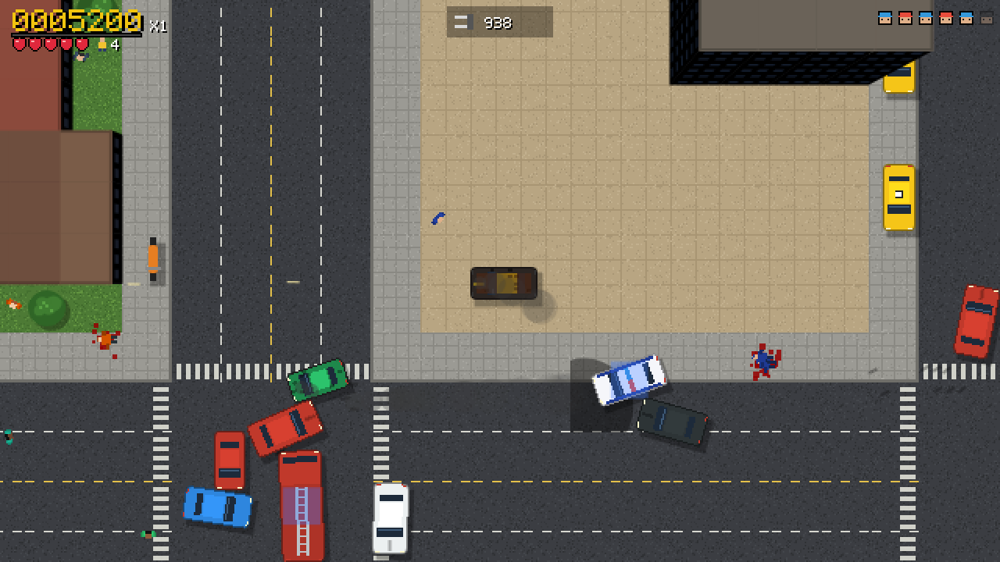

# Bilstöld

A top-down car-theft sandbox in the spirit of the original GTA and GTA 2. It runs in the browser.

You steal cars, pick up weapons and power-ups, answer ringing payphones for jobs, and play the three gangs off against each other. Along the way you try to outrun police who escalate from beat cops to army tanks. Each city is generated from a seed, and the game saves in your browser so you can pick up where you left off.

**Play it:** https://erikhellman.github.io/bilstold/



More screenshots, a 44-second gameplay video ([gameplay.mp4](promo/gameplay.mp4)) and a 512 px icon are in [promo/](promo/).

## Running it

```bash
npm install
npm run dev      # http://localhost:5173
npm run build    # static site in dist/ (~52 KB gzipped JS)
npm test         # vitest: unit, simulation and a 20-minute soak test
npm run test:e2e # Playwright: the real game in Chromium (desktop, phone, gamepad, production build)
```

The browser tests in `e2e/` need Chromium once: `npx playwright install chromium`, or point `PW_CHROMIUM_PATH` at a Chromium you already have.

The game has no runtime dependencies, and there are no image, audio or font files. All sprites, tiles, the bitmap font, the sound effects and the radio music are generated in code at startup.

## Controls

| Keyboard | Gamepad | Action |
|---|---|---|
| — | Left stick | Walk in the stick's direction / steer |
| W / ↑ | RT | Accelerate / walk |
| S / ↓ | LT | Brake / reverse |
| A D / ← → | Left stick | Steer / turn |
| Space | X | Handbrake |
| Ctrl / J | A | Fire |
| Enter / F | Y | Enter or exit a car (carjacks the driver) |
| Q / E | LB / RB or D-pad ← → | Change weapon |
| R | D-pad ↑ | Change radio station (in a car) |
| M | View | City map |
| C | D-pad ↓ | Vehicle registry |
| Esc / P | Menu | Pause and settings |

Gamepad buttons are named Xbox-style; on a PlayStation pad A = Cross, B = Circle, X = Square, Y = Triangle, LB/RB = L1/R1, LT/RT = L2/R2, View = Create, Menu = Options. In menus, move with the D-pad or left stick, select with A and go back with B (B also closes the map and registry). While a pad is connected, the in-game Controls help lists the pad's buttons instead of the keyboard, with PlayStation names on a PlayStation pad.

On phones and tablets (landscape) the game shows touch controls: put a thumb anywhere on the left half for a floating stick, which walks you where it points and, in a car, drives towards where it points (point behind the car to reverse). The right side has Fire, Enter, Drift (handbrake), Brake and Gun (next weapon); Pause, Map and Radio sit along the top. Tap anywhere to close the map. Touch devices start with the battery saver on. Add `?touch=1` to the URL to try the touch controls on a desktop.

There is also a hidden cheats menu for weapons, power-ups, god mode and spawning any car. The title screen drops a hint about how to open it.

## Seeds and saving

- On the title screen you can type a seed (any text, including Swedish letters) or roll a random one. The same seed always builds the same city. `?seed=…` in the URL pre-fills the field.
- Earning 1,000,000 × the city number on top of the score you arrived with unlocks the next city, generated from the same seed. A line under the score and the pause menu show how far you are.
- Mission pay, kill points, car-crusher money and kill-frenzy bonuses are all scaled by your multiplier. Every 4 jobs raise it by one, up to ×4. Jobs get harder and pay more as you go, so a city takes about 20 jobs.
- Running out of lives restarts the city from the score you arrived with, and halves your multiplier.
- The game autosaves every 10 seconds, after each mission, and when the tab is hidden or closed. The save lives in `localStorage` under the key `bilstold.save`. It holds your seed, city, score, lives, weapons, car, wanted level, gang respect, active mission and settings.
- The city itself is not saved; it is rebuilt from the seed. A corrupt save is discarded with a notice.

## The cities

Each city has its own look, gangs and traffic. The seed decides the street layout inside each theme.

| City | Theme | What's different |
|---|---|---|
| 1. Hamnstaden | Harbour town in summer | Coastlines on two sides, ice-cream vans and mopeds, Hamn, Söder and Neon gangs |
| 2. Bruksorten | Mill town in winter | Snow, icy roads where cars slide, factories, pickups and trucks, Järn, Rost and Norr gangs |
| 3. Huvudstaden | The capital at night | Dark streets lit by lamps and headlights, a bigger downtown, sports cars and taxis, more police, Guld, Svart and Krom gangs |

After the third city the cycle starts again, with one more level of police each time round.

## What's in the city

- **Cars:** 17 vehicle types. Among them are taxis, buses, an ice-cream van, police, SWAT (*Insats*), secret police (*SÄPO*), ambulances, fire trucks, a moped and an army tank.
- **Weapons:** pistol, SMG, shotgun, electro-gun, flamethrower, molotovs, grenades and a rocket launcher. Crates on the road give car weapons: machine guns, oil slicks and mines. The bomb shop fits car bombs.
- **Power-ups:** health, armor, cop bribes, Get Outta Jail Free cards, extra lives, multiplier bonuses, double damage, fast reload, invulnerability, electro-fingers and kill frenzies.
- **Police:** six wanted levels, from cops on foot to car chases, roadblocks, SWAT, SÄPO and finally tanks.
  - You lose the police by staying out of sight, using a respray shop ($5000) or picking up a bribe.
  - Getting busted costs you your weapons and your multiplier.
  - Getting wasted costs you a life.
- **Gangs:** three gangs with territories. Each tracks its respect for you, which changes as you kill their members or take jobs from them.
- **Street life:** criminals mug people and steal cars. Ambulances revive the dead, and fire trucks put out fires.
- **Storylines:** each gang's boss calls from a red-ringing phone (marked S on the map) with a five-job storyline, opened by a short briefing. Finish two storylines and a phone downtown (F) opens the city finale, which pays a quarter of the city goal.
- **Missions:** jobs from ringing payphones. They include delivering cars, assassinations, car bombs, checkpoint races, destroying vehicles, taxi rides, the crusher, rampages, escorting someone past gang hit squads, chasing down a fleeing car, getting wanted stars and losing them, and holding a spot against waves of attackers.
- **Between missions:**
  - 20 hidden packages per city. Every 5 you find give you better gear each time you respawn.
  - Getting into a taxi, ambulance, fire truck or police car starts that vehicle's side job. After 10 jobs of one kind you unlock a perk: an extra multiplier, full health regeneration, immunity to fire, or armor at every respawn.
  - 3 street races per city start at the checkered flags (R on the map). Finishing in the top three pays, and your best time is saved.
  - Drifts, near misses and clean getaways from three stars or more pay small bonuses, and so does driving each car model for the first time.
  - The pause menu and the city complete screen show your stats.
- **Radio:** four procedural stations play while you drive: *Radio Bilstöld*, *Hårdrock FM*, *Dansbandet* and *Lugna Favoriter*.

## Health, aiming and difficulty

- You have 200 HP (five hearts of 40). After 6 seconds without taking damage, health slowly regenerates up to half. Health crates restore it fully.
- After a respawn you get 3 seconds of protection. Your own explosions hurt you only half as much.
- Your shots on foot get aim assist: they curve towards a target near where you're facing, preferring whoever is shooting at you.
- Enemies need a moment to aim when they first see you, miss more often at range and don't lead a moving target. When you're hit, the screen edges flash red and an arrow points towards the shooter.
- **Difficulty** (pause menu, saved): *Easy* (enemies hit rarely and softly, wide aim assist), *Normal* (default) or *Hard* (accurate enemies, full damage, narrow aim assist).

## Keeping it light

- **Rendering:** the game draws at 640 px wide and scales up with pixelated filtering. The ground is drawn once into cached 512 px chunks.
- **Simulation:** a fixed 60 Hz step that only covers the area around the player, with hard caps on the number of pedestrians and cars.
- **Background tabs:** the loop and the audio stop completely when the tab is hidden.
- **Battery saver:** a pause-menu option that caps the game at 30 fps.

In dev builds, F3 shows a performance overlay. On a laptop the simulation takes about 0.1 ms per tick and rendering about 1–2 ms per frame.

## Crash reporting

Production builds report uncaught errors to Sentry when the `SENTRY_DSN` repository variable is set (Settings → Secrets and variables → Actions → Variables). The SDK is loaded as a separate ~30 KB chunk after the game starts, and only when a DSN is present; local and fork builds without it ship no Sentry code at all.

## Known limits

- Touch play needs landscape; in portrait the game asks you to turn the device.
- No building interiors, bridges over roads, or multiplayer.
- Traffic AI is deliberately simple and can jam.

## License

[MIT](LICENSE) © 2026 Erik Hellman
